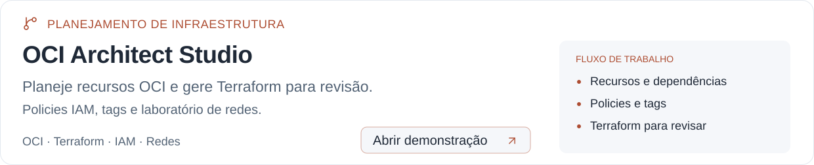
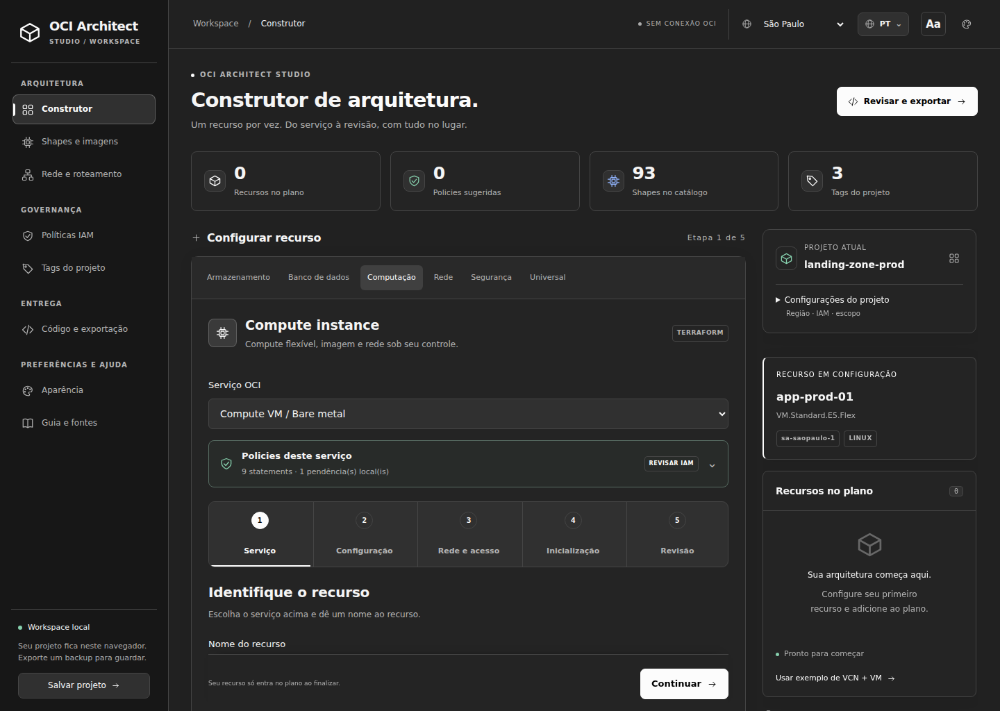
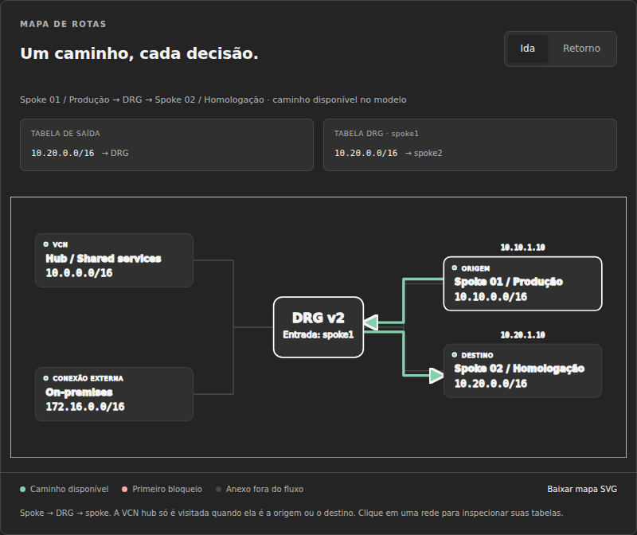

# OCI Architect Studio

<a href="https://cwbffm.github.io/oci-architect-studio/">
<picture>
  <source media="(max-width: 600px) and (prefers-color-scheme: dark)" srcset="assets/repository-cover-mobile-dark.svg">
  <source media="(max-width: 600px) and (prefers-color-scheme: light)" srcset="assets/repository-cover-mobile-light.svg">
  <source media="(prefers-color-scheme: dark)" srcset="assets/repository-cover-dark.svg">
  
</picture>
</a>

Planeje recursos da **Oracle Cloud Infrastructure**, organize as dependências e gere **Terraform ou OCI CLI** para revisar antes da implantação.

**[Abrir demonstração](https://cwbffm.github.io/oci-architect-studio/)** · [Recursos](#recursos) · [Como usar](#como-usar) · [Exemplos](#exemplos-de-uso) · [Validação](#validacao-e-limites)

Uma ferramenta de planejamento que funciona no navegador, sem conexão direta com uma tenancy. O projeto é mantido por [Fabio Ferreira](https://github.com/cwbffm), com foco em infraestrutura OCI, redes e automação.

## Conheça a ferramenta



<details>
<summary>Ver o laboratório de redes e roteamento</summary>



As capturas usam o estado inicial da aplicação e não representam uma tenancy real.

</details>

## Recursos

| Área | O que você pode fazer |
| --- | --- |
| **Planejamento de recursos** | Configurar 22 tipos nativos, organizar referências entre recursos e usar o recurso Universal para HCL manual. |
| **Compute e imagens** | Consultar shapes e sistemas operacionais, configurar Linux ou Windows e distinguir licenciamento nativo de BYOL. |
| **Policies IAM** | Gerar statements de referência e conferir os escopos e as dependências dos serviços. |
| **Tags** | Organizar tags freeform e defined tags e revisar o padrão aplicado ao projeto. |
| **Rede e roteamento** | Explorar uma topologia hub-and-spoke e acompanhar decisões de ida e retorno no laboratório lógico. |
| **Terraform e OCI CLI** | Escolher `main.tf` ou `deploy-oci.sh`, revisar as variáveis e copiar/baixar o formato selecionado. |
| **Aparência e leitura** | Escolher entre 38 variantes de temas, 17 opções de destaque e preferências de leitura. A interface oferece oito idiomas. |
| **Backups e exportação** | Salvar e restaurar o projeto em JSON e exportar uma cópia limpa da ferramenta em HTML. |

## Como usar

1. Abra a [demonstração](https://cwbffm.github.io/oci-architect-studio/) ou baixe o repositório e abra `index.html` no navegador.
2. Selecione a região e configure o contexto do projeto.
3. Escolha um serviço, preencha os campos e associe suas dependências.
4. Revise as policies, as tags e as pendências indicadas pela ferramenta.
5. Escolha Terraform ou OCI CLI na exportação e salve um backup JSON do projeto.

O projeto fica no armazenamento local do navegador. Exporte o backup para preservá-lo ao trocar de navegador, computador ou limpar os dados do site.

### Conferir o Terraform exportado

Na pasta em que você salvou o código gerado, com Terraform e as dependências necessárias disponíveis:

```bash
terraform fmt
terraform init
terraform validate
terraform plan
```

Revise as variáveis, a autenticação, a região e as alterações do plano antes de executar qualquer aplicação na OCI.

### Exportar OCI CLI

Em **Código e exportação**, selecione **OCI CLI** e baixe `deploy-oci.sh`. O script usa comandos nativos da Oracle e requer Bash, Python 3 e OCI CLI autenticada. Variáveis pendentes são preenchidas no terminal. Há suporte aos 22 tipos nativos, respeitando os limites indicados na tela; Universal/HCL e Windows BYOL permanecem em Terraform.

Veja [OCI_CLI.md](OCI_CLI.md) para cobertura, execução, região de origem IAM e validação sem acesso à tenancy. OCI CLI executa criação direta e não mantém state nem plan do Terraform.

## Exemplos de uso

| Situação | Caminho sugerido |
| --- | --- |
| **Planejar uma VCN e uma VM** | Configure a rede, associe a subnet ao Compute e revise imagem, IP, policies e tags. |
| **Revisar permissões de um serviço** | Consulte o workspace de IAM e confira principal, compartimentos e dependências. |
| **Investigar uma rota no modelo** | No laboratório de redes, escolha origem e destino e examine o caminho e as tabelas de rotas. |
| **Preparar um exemplo para discussão técnica** | Organize os recursos, exporte o código e registre as decisões e pendências do projeto. |

<a id="validacao-e-limites"></a>

## Validação e limites

A revisão atual registra a correção das prévias de destaque e a verificação de 32 configurações com `terraform validate`. Consulte [VALIDATION.md](VALIDATION.md) para os resultados, a reprodução das verificações e seus limites.

- A aplicação planeja e gera código; ela não executa Terraform ou OCI CLI nem implanta recursos na sua tenancy.
- O catálogo de referência não garante disponibilidade regional ou capacidade. Importe dados da sua região quando necessário.
- As policies geradas exigem revisão de identidade, escopo e permissões efetivas.
- O laboratório de redes é uma simulação lógica; não envia pacotes nem comprova conectividade real na OCI.
- O HCL manual do recurso Universal exige revisão.
- Confira os testes registrados e seus limites em [VALIDATION.md](VALIDATION.md).

## Documentação do projeto

| Documento | Conteúdo |
| --- | --- |
| [Validação](VALIDATION.md) | Verificações registradas e limites da revisão. |
| [Temas](THEMES.md) | Famílias, modos de aparência e cores de destaque. |
| [Idiomas](I18N.md) | Localização da interface e preservação dos dados do projeto. |
| [Testes](tests/) | Scripts de regressão, idiomas e aparência. |

## Publicação

O workflow [Publish GitHub Pages](.github/workflows/pages.yml) publica `index.html` a cada push na branch `docker-compose`.

A publicação utiliza Ubuntu 24.04 e ações compatíveis com Node.js 24.

Para configurar uma publicação própria, selecione **Settings → Pages → Build and deployment → Source → GitHub Actions**. O workflow também oferece execução manual em **Actions → Publish GitHub Pages → Run workflow**.

## Mais projetos

[Perfil de Fabio Ferreira](https://github.com/cwbffm) · [Laboratório Terraform OCI](https://github.com/cwbffm/oci-terraform-network) · [Scripts e automações](https://github.com/cwbffm/scriptz)
